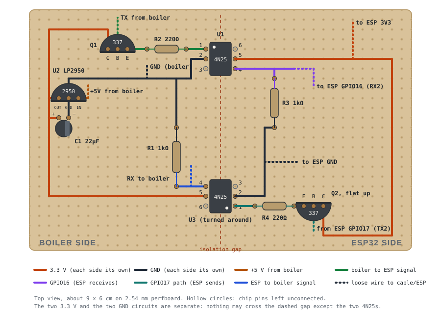

# Building the IDS adapter: a step-by-step guide

This guide is for people who want to build the adapter but are new to electronics (see also
[issue #11](https://github.com/little-chef/intergas-xtreme-monitor/issues/11)). It turns the
[schematic](./images/schematic.png) into a perfboard layout, explains every connection by
component and pin number, and ends with a safe first software test.

There is no PCB design in this repository (the `.kicad_pcb` file is empty), so this guide uses
a piece of perfboard (stripless, 2.54 mm grid). It was written while building one for an
**Intergas Xtreme 30** with a generic ESP32-WROOM-32 dev board and ESPHome 2026.9, and that
build works.

Nothing here is supported by Intergas. A wiring mistake on the boiler side can damage the
boiler's control board, so take the checks seriously.

## How it works

The adapter has two halves that never touch electrically:

- **Boiler side.** Powered by the boiler's own 5 V from the X14 connector. A small regulator
  (U2) turns that into 3.3 V for the boiler-side signals.
- **ESP side.** The ESP32 and its own USB power supply.

The two halves only talk through two **optocouplers** (4N25): a small LED and a light sensor in
one chip. One carries data from the boiler to the ESP, the other from the ESP to the boiler.
Because only light crosses between them, a fault on one side can't travel to the other.

Two rules follow from this, and they protect your boiler:

1. **Never connect the ESP32's 5V/VIN pin to anything on this board.** The ESP gets its own USB
   power, also at the boiler.
2. **Nothing may bridge the gap between the halves** (no wire, solder blob or leg), except the
   two optocouplers.

## Parts

| Ref | Part | Value | Notes |
|---|---|---|---|
| U1, U3 | 4N25 optocoupler | | 6-pin DIP |
| Q1, Q2 | BC337 NPN transistor | | TO-92 |
| U2 | LP2950-3.3 regulator | 3.3 V | TO-92, looks like the transistors |
| C1 | Electrolytic capacitor | 22 µF, 10 V or more | has a + and a − leg |
| R1, R3 | Resistor | 1 kΩ | |
| R2, R4 | Resistor | 220 Ω | |
| J1 | Molex Mini-Fit Jr 4-pin housing + 4 female terminals | | see the [README](./README.md#physical-connection) for part numbers |
| | ESP32 dev board | | NodeMCU-32S or any ESP32-WROOM-32 board with GPIO16/17 |
| | Perfboard | about 9 × 6 cm | |
| | Hook-up wire, a 4-core cable for the boiler, 4 female Dupont jumpers for the ESP | | |
| | USB power supply for the ESP at the boiler | | not the X14 5 V |

The schematic also shows an **RJ45** connector (an optional way to run the boiler cable over a
network cable) and an **optional** block with three DS18B20 temperature sensors and a 4.7 kΩ resistor. You don't
need either; see [The optional part](#the-optional-part-of-the-schematic) at the end.

## Know your parts

- **4N25.** Small black chip with six legs and a dot (or notch) at one end. The dot marks pin 1.
  Pins 1, 2, 3 run down the dot side; 4, 5, 6 come back up the other side, so pin 6 sits
  opposite pin 1.
- **BC337 and LP2950.** Both are small black "D" shapes with three legs. Read the tiny print on
  the flat face: `337` is a transistor, `2950` is the regulator. Hold one with the flat face
  toward you, legs down:
  - BC337: **C B E** (collector, base, emitter) left to right.
  - LP2950: **OUT GND IN** left to right.
- **Resistors.** Read the colour bands from the end where they are closest together. 1 kΩ is
  brown black black brown (then brown); 220 Ω is red red black black (then brown). If in doubt,
  measure on the Ω setting. Resistors have no direction.
- **22 µF capacitor.** It has a direction: the **long leg is +**, the side with the stripe is −.
  The wrong way round, it can pop.

## Every connection, by component and pin

This is the schematic as a list. Each row is one connection (a "net"): everything in the right
column gets wired together.

**Boiler side**

| Net | Connects |
|---|---|
| Boiler +5 V (X14) | U2 IN |
| Boiler GND (X14) | U2 GND, C1 −, R1 (one end), U1 pin 2 |
| Boiler 3.3 V | U2 OUT, C1 +, Q1 C, U3 pin 5 |
| Boiler TX (X14, the boiler sends) | Q1 B |
| (Q1 to U1) | Q1 E, R2 (one end); R2 (other end), U1 pin 1 |
| Boiler RX (X14, the boiler receives) | U3 pin 4, R1 (other end) |

**ESP side**

| Net | Connects |
|---|---|
| ESP 3V3 | ESP "3V3" pin, U1 pin 5, Q2 C |
| ESP GND | ESP "GND" pin, U3 pin 2, R3 (one end) |
| GPIO16 (ESP receives, RX2) | U1 pin 4, R3 (other end) |
| GPIO17 (ESP sends, TX2) | Q2 B |
| (Q2 to U3) | Q2 E, R4 (one end); R4 (other end), U3 pin 1 |

**Not connected:** U1 pins 3 and 6, U3 pins 3 and 6.

**Why these parts.** The boiler's TX line and the ESP's GPIO17 can't drive an LED on their own,
so each one drives a transistor (Q1, Q2) that does it for them. R2 and R4 (220 Ω) set the LED
current to about 6 mA; the transistors need no extra base resistor in this circuit. R1 and R3
(1 kΩ) pull each optocoupler's output down to 0 V when its LED is off. Don't swap in other
values: a larger R2/R4 means less LED current, and the 4N25 output is the weakest point of the
design.

## Wiring map

The board seen from the top, where the parts sit. Every brown dot is a solder joint; every
coloured line is one connection. Make each line with a piece of insulated wire, or bend one
part's leg over to its neighbour underneath and solder them together.



Note that **U3 is turned around** compared to U1 (its dot is at the bottom-right), and **Q2's
flat face points up** while Q1's points down. That keeps the wires short.

## Build it, one block at a time

Build and test in this order, so a mistake shows up early.

### Block 1: power (boiler side)

- [ ] Place **U2 (LP2950)** near the left edge, flat face toward the bottom edge of the board, so
  its legs read OUT, GND, IN from left to right. Double-check before soldering: soldering it
  rotated puts 5 V on its output and it won't work (an easy mistake to make).
- [ ] Place **C1** just below U2: long leg (+) to OUT, striped leg (−) to GND.
- [ ] Run the **boiler 3.3 V** wire from U2 OUT along the left edge. Its ends go to Q1 C and
  U3 pin 5 later.
- [ ] Run the **boiler GND** wire from U2 GND to the right. Its ends go to U1 pin 2 and R1 later.
- [ ] Solder two short temporary test wires: one next to U2 IN (+5 V), one onto the GND wire.
- [ ] **Test:** feed 5 V into those two wires (see [Bench power](#bench-power)). A multimeter
  between U2 OUT and GND should read about **3.3 V**. If it reads 5 V or 0 V, U2 is probably the
  wrong way round.

### Block 2: boiler to ESP channel (top half)

- [ ] Place **U1** across the middle, dot at the top-left. Solder all six pins (pins 3 and 6 stay
  unconnected, but soldering them holds the chip).
- [ ] Place **Q1 (BC337)** left of U1, flat face toward the bottom edge: C, B, E from left to
  right. Connect **C** to the boiler 3.3 V wire.
- [ ] Place **R2 (220 Ω)** between Q1 and U1. Join Q1 **E** to R2, and R2's other end to
  **U1 pin 1**.
- [ ] Connect **U1 pin 2** to the boiler GND wire.
- [ ] On the ESP side, place **R3 (1 kΩ)** below U1's right side. Connect **U1 pin 4** to R3's
  top end; a loose wire will go from there to ESP GPIO16.
- [ ] Connect **U1 pin 5** to the ESP 3.3 V wire (it runs along the top and down the right edge,
  to Q2 later).

### Block 3: ESP to boiler channel (bottom half)

- [ ] Place **U3** across the middle, **the other way round**: dot at the bottom-right, so pin 1
  is the bottom-right pin. Solder all six pins.
- [ ] Place **R1 (1 kΩ)** left of U3. Join one end to **U3 pin 4**, the other to the boiler GND
  wire.
- [ ] Connect **U3 pin 5** to the boiler 3.3 V wire.
- [ ] On the ESP side, place **R4 (220 Ω)** right of U3, and **Q2 (BC337)** right of it with
  its **flat face toward the top edge**, so its legs read E, B, C from left to right. Join
  U3 pin 1 to R4, and R4 to Q2 **E**.
- [ ] Connect Q2 **C** to the ESP 3.3 V wire.
- [ ] Connect **U3 pin 2** to R3's bottom end with the ESP GND wire.

### Block 4: wires to the ESP32 and the boiler cable

- [ ] Four wires to the ESP32: **ESP 3.3 V wire to "3V3"**, **ESP GND wire to "GND"**,
  **U1 pin 4 / R3 to "16"** (may be labelled RX2), **Q2 B to "17"** (may be labelled TX2).
  Leave the ESP's 5V/VIN pin unconnected.
- [ ] The boiler cable, one wire per signal: **+5 V to U2 IN**, **GND to the boiler GND wire**,
  **TX to Q1 B**, **RX to U3 pin 4 / R1**. Write down your colours. Remove the temporary test
  wires from block 1, and tie the cable to the board so it can't pull on the joints.

### Block 5: checks before power

- [ ] Look underneath with good light: no solder blobs joining neighbouring holes, especially
  between the two halves.
- [ ] Multimeter on continuity (beep): boiler GND to ESP GND must **not** beep. Boiler +5 V and
  boiler 3.3 V to anything on the ESP side must **not** beep.
- [ ] Within each side, all points of one net beep to each other (for example all boiler GND
  points).

## Bench power

For the bench tests the boiler side needs 5 V on its +5 V and GND wires. Best is a second USB
charger with an old USB cable cut open (red is +5 V, black is GND). If you don't have one, you
can borrow 5V and GND from the ESP32's own pins with two jumper wires, **only on the bench**:
remove them before the adapter goes near the boiler, because they bridge the isolation.

## The X14 plug

Crimp one terminal per wire and push them into the Molex housing until they click. Hold the plug
with its **latch on the left**, looking at the side where the wires go in (this is the same view
as looking straight into the boiler's X14 header):

| Position | Signal | On the board |
|---|---|---|
| top-left | +5 V | U2 IN |
| bottom-left | GND | boiler GND wire |
| top-right | TX (boiler sends) | Q1 B |
| bottom-right | RX (boiler receives) | U3 pin 4 / R1 |

This matches [pinout-X14.png](./images/pinout-X14.png). Orient by the latch, not by numbers
moulded on the plug. If you have a multimeter, check the plug at the boiler before soldering the
cable to the board: with the boiler on and the loose ends apart, +5 V to GND reads about 5 V and
TX to GND about 3.3 V.

## Software, step 1: a read-only test

Before installing the full firmware, which can also **change** boiler settings, test the link
with a minimal configuration that can only read. It sends the boiler's status request every
10 seconds and prints the raw bytes in both directions.

You need [uv](https://docs.astral.sh/uv/) (or a normal ESPHome install; then drop `uvx` from
the commands below). In a new folder, create `secrets.yaml` with the same five keys as in the
[README](./README.md#sw-installation). An API key can be generated with `openssl rand -base64 32`.
Then create `intergas-xtreme-probe.yaml`:

```yaml
# Read-only link test: no custom component, no writable entities.
substitutions:
  # Same name as the full firmware, so the ESPHome dashboard can later
  # install that firmware over Wi-Fi.
  devicename: intergas-xtreme-monitor

esphome:
  name: ${devicename}

esp32:
  board: nodemcu-32s   # use esp32dev for a generic ESP32-WROOM-32 board
  framework:
    type: esp-idf

uart:
  - id: uart_boiler
    rx_pin: GPIO16
    tx_pin: GPIO17
    baud_rate: 9600
    debug:
      direction: BOTH
      # Must be true: nothing else reads the UART here, and without a reader
      # the replies are never logged.
      dummy_receiver: true
      after:
        # The reply is binary and can contain 0x0D anywhere, so split on a pause.
        timeout: 50ms
      sequence:
        - lambda: UARTDebug::log_hex(direction, bytes, ':');

logger:
  hardware_uart: UART0
  level: DEBUG

# Status request "S?\r" plus its XOR checksum byte (0x53 ^ 0x3F ^ 0x0D = 0x61).
interval:
  - interval: 10s
    startup_delay: 10s
    then:
      - uart.write:
          id: uart_boiler
          data: [0x53, 0x3F, 0x0D, 0x61]

wifi:
  ssid: !secret esphome_wifi_network_ssid
  password: !secret esphome_wifi_network_password
  ap:
    password: !secret esphome_wifi_ap_fallback_password

captive_portal:

api:
  encryption:
    key: !secret esphome_hassio_api_encryption_key

ota:
  platform: esphome
  password: !secret esphome_hassio_ota_pw
```

**On the bench.** Connect the ESP32 by USB and run:

```
uvx esphome run intergas-xtreme-probe.yaml
```

The log shows the ESP joining Wi-Fi (note its IP address) and, every 10 seconds,
`>>> 53:3F:0D:61`. No reply comes back yet; that's expected.

Optional extra bench checks, with the boiler side also on 5 V:

- Between the boiler RX wire and boiler GND: about 3.3 V (GPIO17 rests high, and U3 passes it
  through).
- Touch the boiler TX wire to U2 OUT: ESP GPIO16 to ESP GND now reads about 3.3 V; let go and it
  drops to about 0 V.

**At the boiler.**

1. Switch the boiler off.
2. Plug the adapter into X14.
3. Power the ESP from its own USB supply.
4. Switch the boiler on.
5. Watch the log over Wi-Fi: `uvx esphome logs intergas-xtreme-probe.yaml --device <the ESP's IP>`.

Each request should now get a 33-byte reply (32 data bytes plus a checksum):

```
>>> 53:3F:0D:61
<<< 9B:09:16:08:14:EC:F9:08:14:EC:25:08:A0:00:00:00:14:EC:14:EC:81:3E:00:00:7E:00:80:40:20:04:00:FF:2A
```

Temperatures are 2-byte values, low byte first, divided by 100 (see `getTemp()` in
[IntergasXtremeMonitor.cpp](./esphome/IntergasXtremeMonitor.cpp)). In the example: bytes 0-1
`9B 09` = 0x099B = 24.59 °C heat exchanger, bytes 12-13 `A0 00` = 1.60 bar, byte 24 `7E` (126) =
central heating idle, and `14 EC` (-51.00) means "no sensor fitted".

**Only `>>>` lines, no `<<<`?** Check that `dummy_receiver` is `true`, that the boiler was
switched on after plugging in, and that TX and RX aren't swapped at the plug. Then do the bench
checks above.

## Software, step 2: the full firmware

Once the replies come in, follow [SW Installation](./README.md#sw-installation) in the README.
Because the test configuration uses the same device name and secret names, the ESPHome dashboard
can install the full firmware over Wi-Fi; otherwise install it by USB the first time.

## The optional part of the schematic

The block marked "Optional" adds three DS18B20 one-wire temperature sensors, for example on the
heating flow and return pipes. They have nothing to do with the boiler connection and live on the **ESP side**:
the sensors share one bus: each sensor's VDD to ESP 3V3, GND to ESP GND and DQ (data) to
**GPIO27**, with a single 4.7 kΩ resistor between DQ and 3V3. Enable them in the `dallas_temp` section of
[intergas-xtreme-monitor.yaml](./esphome/intergas-xtreme-monitor.yaml). Skip it if you only want
the boiler data.
